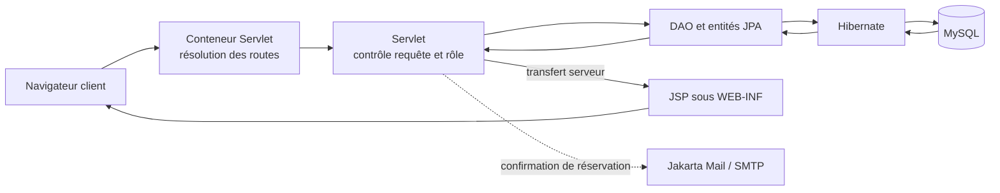

# Cynemma

**Cynemma** est une application web de gestion de cinéma qui associe une expérience visuelle éditoriale à un socle Java Jakarta : catalogue de films, programmation, gestion des comptes et réservation de places. Le projet est conçu comme une application web Java déployée en WAR, avec des interfaces JSP adaptées aux rôles visiteur, client, employé et administrateur.

> Le périmètre et les versions indiqués ci-dessous correspondent au code présent dans le dépôt. Les éléments envisagés ou non retrouvés dans les sources ne sont pas décrits comme des fonctions disponibles.

## Sommaire

- [Présentation](#présentation)
- [Fonctionnalités](#fonctionnalités)
- [Direction artistique et expérience utilisateur](#direction-artistique-et-expérience-utilisateur)
- [Accessibilité](#accessibilité)
- [Technologies](#technologies)
- [Architecture](#architecture)
- [Organisation du dépôt](#organisation-du-dépôt)
- [Prérequis](#prérequis)
- [Installation et configuration](#installation-et-configuration)
- [Parcours dans l’application](#parcours-dans-lapplication)
- [Tests et limites connues](#tests-et-limites-connues)
- [Dépannage](#dépannage)
- [Contribution](#contribution)
- [Licence](#licence)

## Présentation

Cynemma couvre les principaux besoins d’un cinéma : présenter les films à l’affiche, organiser les séances, administrer les salles et les comptes, puis permettre à un client connecté de réserver des places. L’application s’appuie sur des pages JSP rendues côté serveur et des servlets Java qui orchestrent les actions et l’accès aux données.

Le projet se distingue notamment par une interface sombre, typographique et composée sur mesure en CSS, plutôt que par l’emploi d’un framework d’interface prêt à l’emploi.

## Fonctionnalités

| Espace | Capacités présentes dans le code |
| --- | --- |
| Visiteur | Consulter la page d’accueil et les films, créer un compte et se connecter |
| Client | Parcourir les films et séances, effectuer une réservation de places et afficher son résultat |
| Employé | Créer, modifier et supprimer des films ; créer et consulter les séances |
| Administrateur | Consulter et gérer les comptes, modifier les rôles et ajouter des salles |
| Transverse | Changer le mot de passe, se déconnecter, téléverser une affiche de film |

La réservation enregistre les billets et les sièges disponibles en base. Le serveur tente également d’envoyer un courriel de confirmation avec Jakarta Mail. L’envoi dépend de la configuration SMTP du projet et d’un serveur accessible.

**Périmètre non confirmé dans les sources actuelles :** je n’ai trouvé ni moteur de sélection de sièges en 3D basé sur Three.js, ni code JavaScript dans l’application. La réservation existante sélectionne les sièges disponibles côté serveur ; le README ne la présente donc pas comme une expérience 3D interactive.

## Direction artistique et expérience utilisateur

La feuille de style [style.css](cynemma/src/main/webapp/css/style.css) met en place un design system CSS propre au projet : palette sombre à tonalités chaudes, surfaces en couches, accent ambre, échelle d’espacement, rayons et transitions définis par variables CSS.

Les choix visuels constatés comprennent :

- **Une typographie éditoriale** : Fraunces pour les titres et Atkinson Hyperlegible Next pour le texte courant, chargées via Google Fonts avec des polices de repli.
- **Une composition asymétrique** : grands titres, espaces généreux et mise en page de catalogue décalée sur les écrans larges.
- **Un effet de verre discret** : l’en-tête fixe utilise une transparence, une saturation et un flou d’arrière-plan lorsque le navigateur les prend en charge — une approche *glass-inspired*, et non une implémentation complète d’Apple Liquid Glass.
- **Des visuels de cinéma travaillés en CSS** : image de couverture, dégradés de superposition et halo coloré, ainsi qu’une composition de catalogue décalée et des effets de survol.

L’ensemble revendique une inspiration contemporaine proche des interfaces éditoriales et des conventions de finition des plateformes Apple, tout en restant réalisé en CSS standard. L’effet d’affiche isométrique 3D avec reflets n’est pas établi dans les sources consultées : il n’est pas présenté ici comme une fonctionnalité livrée.

## Accessibilité

L’interface comprend plusieurs aménagements repérables dans le code :

- lien d’évitement vers le contenu principal ;
- éléments HTML sémantiques et libellés accessibles sur plusieurs zones ;
- indicateurs de focus visibles pour les liens, boutons, champs et zones défilantes ;
- adaptations CSS à `prefers-reduced-motion` ;
- styles d’impression et prise en compte du mode de contraste forcé.

Ces pratiques contribuent à une navigation plus inclusive. **Aucune campagne de tests ou certification RGAA 4.1.2 / WCAG 2.2 AA n’a été identifiée dans le dépôt** ; les niveaux de conformité, la navigation clavier exhaustive et un ratio de contraste supérieur à 4,5:1 ne sont donc pas garantis par cette documentation.

## Technologies

| Technologie | Utilisation |
| --- | --- |
| Java | Servlets, logique applicative et accès aux données. Le POM configure `maven.compiler.release` à **25**. |
| Jakarta Servlet 6.1 | Contrôleurs HTTP et annotations de servlet. |
| JSP et JSTL | Vues rendues côté serveur et affichage conditionnel. |
| Jakarta Persistence (JPA) et Hibernate 6.5 | Mapping objet-relationnel et persistance. |
| MySQL | Base relationnelle ; pilote Connector/J 8.3. |
| Maven | Dépendances et assemblage d’une archive WAR. |
| BCrypt (`jbcrypt`) | Hashage des mots de passe lors de la création et de la mise à jour. |
| Jakarta Mail | Envoi du courriel de confirmation de réservation. |
| CSS | Design system et styles de l’interface, sans framework CSS détecté. |

Références : [Jakarta Servlet](https://jakarta.ee/specifications/servlet/), [Jakarta Persistence](https://jakarta.ee/specifications/persistence/), [Hibernate ORM](https://hibernate.org/orm/), [Maven](https://maven.apache.org/).

## Architecture

Cynemma suit une séparation de type MVC côté serveur : les requêtes HTTP arrivent aux servlets, qui utilisent les DAO et les entités JPA, puis transmettent les données aux JSP. Les JSP sont placées sous `WEB-INF` et rendues par transfert serveur plutôt que d’être directement accessibles par URL.



### Contrôle d’accès et sécurité

Les servlets effectuent des vérifications de session et de rôle pour plusieurs opérations. La protection CSRF est appelée sur des actions sensibles et les mots de passe sont hashés avec BCrypt à leur enregistrement ou changement. Les vues JSP sont rangées sous `/WEB-INF/`, ce qui empêche leur accès direct par le navigateur et les laisse accessibles par transfert interne.

**Limite importante :** aucune classe annotée `@WebFilter` n’a été trouvée dans le code analysé. Le contrôle observé est effectué dans les servlets concernées ; il ne faut donc pas supposer qu’un filtre global protège automatiquement tous les chemins comme `/admin` ou `/employe`.

### Modèle métier

Les principales entités sont `Utilisateur` (avec les rôles client, employé et administrateur), `Film`, `Salle`, `Rangee`, `Siege`, `Seance`, `Reservation`, `Billet` et `CarteFidelite`. Le script SQL [init_database.sql](cynemma/init_database.sql) décrit notamment les liens entre films et séances, salles et rangées, puis réservations, billets et sièges.

## Organisation du dépôt

```text
Cin-ma/
├── README.md
└── cynemma/
    ├── pom.xml
    ├── init_database.sql
    ├── populate_kanboard.py
    └── src/
        ├── main/
        │   ├── java/fr/turgot/
        │   │   ├── dao/           # DAO et modèles JPA
        │   │   ├── servlet/       # Routes et contrôleurs
        │   │   └── utils/         # JPA, CSRF, sessions et utilitaires
        │   ├── resources/         # persistence.xml
        │   └── webapp/            # JSP, CSS, images et descripteur web
        └── test/java/             # Aucun test Java présent actuellement
```

## Prérequis

- JDK correspondant à la version de compilation configurée dans le projet : **Java 25** (`maven.compiler.release` dans [pom.xml](cynemma/pom.xml)).
- Maven.
- MySQL compatible avec le schéma de [init_database.sql](cynemma/init_database.sql) ; le script signale que MySQL 8.0.16 ou supérieur applique les contraintes `CHECK`.
- Un conteneur web compatible avec Jakarta Servlet 6.1 pour déployer le WAR. Vérifier la compatibilité entre le conteneur choisi et le JDK 25 de l’environnement.

Le dépôt ne contient pas de wrapper Maven, de configuration Docker ou de script de lancement de conteneur.

> **Version Java :** le dépôt ne cible pas Java 17 ou 21 actuellement. Bien que ces versions soient des LTS courantes, les présenter comme versions compatibles sans modifier et tester le POM serait trompeur. Pour employer une LTS, il faudrait abaisser et valider la version de compilation dans le projet.

## Installation et configuration

Les commandes suivantes supposent que Git, Maven, le client MySQL et un conteneur Servlet compatible sont installés.

1. Récupérer le dépôt et entrer dans le module Maven :

   ```bash
   git clone https://github.com/Mateo456075/Cin-ma.git
   cd Cin-ma/cynemma
   ```

2. Créer la base et importer son schéma :

   ```bash
   mysql -u <UTILISATEUR_MYSQL> -p -e \
     "CREATE DATABASE cynema CHARACTER SET utf8mb4 COLLATE utf8mb4_unicode_ci;"
   mysql -u <UTILISATEUR_MYSQL> -p cynema < init_database.sql
   ```

3. Configurer les paramètres de connexion à MySQL pour votre environnement dans [persistence.xml](cynemma/src/main/resources/META-INF/persistence.xml). Le fichier contient actuellement une URL locale sur le port `8889` ; adaptez l’URL, l’utilisateur et le mot de passe à votre installation. Ne publiez pas de secrets.

4. Construire l’application :

   ```bash
   mvn clean package
   ```

5. Déployer `target/cinema.war` dans le répertoire de déploiement de votre conteneur web. Avec un répertoire Tomcat défini par `CATALINA_HOME` :

   ```bash
   cp target/cinema.war "$CATALINA_HOME/webapps/"
   ```

6. Démarrer le conteneur selon son installation. Avec Tomcat, l’application est normalement accessible à `http://localhost:8080/cinema/`. La page d’accueil déclarée par l’application est `/accueil`.

### Base de données

La configuration JPA définit l’unité de persistance `cynemma`, Hibernate comme fournisseur et une connexion MySQL en mode `RESOURCE_LOCAL`. Hibernate est configuré avec `hibernate.hbm2ddl.auto=update` : il peut mettre à jour le schéma au démarrage. Le script SQL reste fourni pour initialiser explicitement les tables.

Les tables déclarées par le script sont `utilisateurs`, `cartes_fidelite`, `configuration_salles`, `salles`, `rangees`, `sieges`, `films`, `seances`, `reservations` et `billets`.

## Parcours dans l’application

### Visiteur

Consulter les films à l’affiche, créer un compte, puis se connecter.

### Client

Ouvrir l’espace client, choisir un film, consulter ses séances et réserver des places disponibles. La disponibilité est vérifiée côté serveur et la réservation est enregistrée en base. Une confirmation par email est tentée après la réservation ; son fonctionnement nécessite un serveur SMTP configuré et joignable.

La sélection 3D des sièges avec Three.js n’est pas présente dans les sources actuelles.

### Employé

Créer et gérer les films, téléverser une affiche, programmer des séances et consulter la programmation.

### Administrateur

Consulter les comptes, modifier leurs rôles, supprimer un utilisateur et ajouter une salle.

Aucun compte de démonstration ni identifiant par défaut n’est fourni dans cette documentation.

## Tests et limites connues

Aucun fichier de test Java n’a été trouvé sous `src/test/java`. Maven est déclaré comme outil de build, mais la présence de JUnit dans le POM ne signifie pas qu’une suite de tests existe.

Commandes disponibles :

```bash
mvn test
mvn clean package
```

La compilation n’a pas été vérifiée lors de la rédaction de cette documentation : Maven n’était pas disponible dans l’environnement d’exécution.

## Dépannage

| Symptôme | Vérifications |
| --- | --- |
| Échec de connexion à MySQL | Vérifier que MySQL est démarré, que la base `cynema` existe et que l’URL, le port et les identifiants de `persistence.xml` sont adaptés. |
| Erreur de compilation | Vérifier la version du JDK : le POM demande la version de langage 25. Vérifier aussi l’installation de Maven. |
| Erreur HTTP 403 lors d’une action | Vérifier que l’utilisateur possède le rôle attendu et que le formulaire inclut le jeton CSRF lorsqu’il est requis. |
| Échec d’upload d’affiche | Le serveur n’accepte que les images PNG/JPEG valides et limite la taille et les dimensions ; consulter `CreatFilmServlet`. |
| Email de réservation non reçu | Vérifier les paramètres et l’accès SMTP utilisés par l’application. Ne pas exposer d’identifiants de messagerie. |

## Contribution

Le dépôt ne définit pas de guide de contribution spécifique. Pour proposer une modification, créez une branche, effectuez les changements ciblés, puis lancez les vérifications disponibles :

```bash
git checkout -b feature/ma-modification
mvn test
mvn clean package
```

Proposez ensuite vos changements via le mécanisme de revue utilisé par le dépôt.

## Licence

Aucune licence n’a été identifiée dans le dépôt. Les conditions de réutilisation ne sont donc pas précisées.
