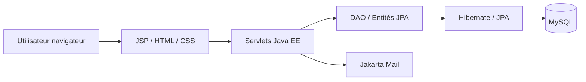

# Cynemma

Cynemma est une application web de gestion de cinéma développée en Java EE avec JSP, servlets, JPA/Hibernate et MySQL. Elle permet de gérer le catalogue des films, la programmation des séances, les comptes utilisateurs et les réservations côté client, dans un contexte de projet académique orienté gestion de cinéma.

Le code principal du projet se trouve dans le sous-dossier [cynemma](cynemma).

## Sommaire

- [Présentation du projet](#présentation-du-projet)
- [Fonctionnalités](#fonctionnalités)
- [Technologies utilisées](#technologies-utilisées)
- [Architecture et organisation du projet](#architecture-et-organisation-du-projet)
- [Prérequis](#prérequis)
- [Installation et configuration](#installation-et-configuration)
- [Configuration de la base de données](#configuration-de-la-base-de-données)
- [Utilisation de l'application](#utilisation-de-l'application)
- [Tests et qualité du code](#tests-et-qualité-du-code)
- [Dépannage](#dépannage)
- [Contribution](#contribution)
- [Licence](#licence)

## Présentation du projet

Cynemma répond à un besoin classique de gestion de cinéma : proposer une vitrine publique des films à l'affiche, gérer la programmation des séances, sécuriser l'accès selon le rôle de l'utilisateur et permettre à un client de réserver des places en ligne.

Le projet s'organise autour d'un modèle simple :

- un site public pour consulter les films et les séances ;
- un espace client pour choisir une séance et réserver des places ;
- un espace employé pour gérer les films et la programmation ;
- un espace administrateur pour gérer les comptes et les salles.

L'application repose sur une architecture Java EE MVC légère : servlets pour le contrôle, JSP pour les vues, JPA/Hibernate pour la persistance et MySQL pour le stockage des données.

## Fonctionnalités

| Catégorie | Fonctionnalité | Statut |
| --- | --- | --- |
| Public | Page d'accueil et catalogue des films | ✅ Implémenté |
| Authentification | Création de compte, connexion, changement de mot de passe, déconnexion | ✅ Implémenté |
| Client | Espace client, consultation des séances, réservation de places | ✅ Implémenté |
| Client | Confirmation d'achat par email via Jakarta Mail | ✅ Implémenté |
| Employé | Création d'un film avec upload d'affiche | ✅ Implémenté |
| Employé | Création d'une séance et gestion de la programmation | ✅ Implémenté |
| Employé | Consultation de la liste des films et séances | ✅ Implémenté |
| Employé | Suppression / modification des films | ⚠️ Implémentation présente dans le code et les écrans liés |
| Admin | Gestion des utilisateurs et modification des rôles | ✅ Implémenté |
| Admin | Ajout de salles | ✅ Implémenté |
| Admin | Gestion avancée des salles et des configurations | ⚠️ Partiellement implémentée |

### Fonctionnalités réellement observées dans le code

- Authentification des utilisateurs avec validation de login et mot de passe : [AuthentificationServlet.java](cynemma/src/main/java/fr/turgot/servlet/AuthentificationServlet.java)
- Création d'un compte client : [CreatServlet.java](cynemma/src/main/java/fr/turgot/servlet/CreatServlet.java)
- Changement de mot de passe : [ChangePasswordServlet.java](cynemma/src/main/java/fr/turgot/servlet/ChangePasswordServlet.java)
- Espace client : [ClientServlet.java](cynemma/src/main/java/fr/turgot/servlet/client/ClientServlet.java)
- Réservation de billets et email de confirmation : [BilletServlet.java](cynemma/src/main/java/fr/turgot/servlet/client/BilletServlet.java)
- Gestion du catalogue par les employés : [CreatFilmServlet.java](cynemma/src/main/java/fr/turgot/servlet/employe/CreatFilmServlet.java)
- Gestion des salles et des rôles par l'administrateur : [RoleModifierServlet.java](cynemma/src/main/java/fr/turgot/servlet/admin/RoleModifierServlet.java)

## Technologies utilisées

| Technologie | Rôle dans le projet |
| --- | --- |
| Java 25 (déclaré dans le POM) | Langage principal de l'application |
| Jakarta Servlet / JSP | Routage HTTP et rendu des vues HTML |
| Maven | Gestion des dépendances et packaging du projet en WAR |
| Hibernate / JPA | Persistance ORM et mapping des entités |
| MySQL | Base de données relationnelle du système |
| JSTL | Affichage dynamique côté JSP |
| BCrypt | Hashage des mots de passe |
| Jakarta Mail | Envoi d'emails de confirmation de réservation |
| Vanilla CSS | Interface utilisateur sans framework front-end |

Le projet est documenté dans [pom.xml](cynemma/pom.xml) et la configuration JPA dans [persistence.xml](cynemma/src/main/resources/META-INF/persistence.xml).

## Architecture et organisation du projet

### Arborescence principale

```text
cynemma/
├── init_database.sql              # Script SQL de création du schéma
├── pom.xml                       # Définition Maven du projet
├── populate_kanboard.py          # Script utilitaire de gestion de backlog
├── src/main/java                 # Sources Java (servlets, DAO, modèles, utilitaires)
│   ├── fr/turgot/dao            # Accès aux données
│   ├── fr/turgot/servlet        # Points d'entrée HTTP
│   └── fr/turgot/utils          # Outils transverses (JPA, session, CSRF)
├── src/main/resources/META-INF  # Configuration JPA / persistence
├── src/main/webapp              # Vues JSP, CSS, images, web.xml
├── src/test/java                # Dossier de tests, actuellement vide
└── target                       # Artefact de build généré (si présent)
```

### Architecture logique



### Architecture observée

- Les vues sont dans [src/main/webapp](cynemma/src/main/webapp).
- Les contrôleurs HTTP sont dans [src/main/java/fr/turgot/servlet](cynemma/src/main/java/fr/turgot/servlet).
- Les entités métier de la base sont dans [src/main/java/fr/turgot/dao/model](cynemma/src/main/java/fr/turgot/dao/model).
- Les accès à la base sont centralisés dans [src/main/java/fr/turgot/dao](cynemma/src/main/java/fr/turgot/dao).
- La session et le contrôle de rôles sont gérés via les utilitaires dans [src/main/java/fr/turgot/utils](cynemma/src/main/java/fr/turgot/utils).

### Modèle métier principal

Les entités les plus importantes sont :

- `Utilisateur` et ses sous-types `Client`, `Employe`, `Administrateur`
- `Film`
- `Salle`
- `Rangee`
- `Siege`
- `Seance`
- `Reservation`
- `Billet`
- `CarteFidelite`

Le schéma complet est décrit dans [init_database.sql](cynemma/init_database.sql).

## Prérequis

Le projet est conçu pour un environnement Java EE avec base MySQL. Les éléments suivants sont nécessaires :

- JDK 25 (donné par la propriété `maven.compiler.release` dans [pom.xml](cynemma/pom.xml))
- Maven 3.x pour empaqueter le projet
- MySQL 8.x recommandé, compatible avec les contraintes SQL déclarées dans [init_database.sql](cynemma/init_database.sql)
- Un conteneur Jakarta EE compatible, par exemple Tomcat 10.1.x
- Une base de données MySQL de développement accessible localement

Le projet ne fournit pas de wrapper Maven ou Docker prêt à l'emploi.

## Installation et configuration

1. Cloner le dépôt :

```bash
git clone <url-du-depot>
cd Cin-ma/cynemma
```

2. Créer la base de données et importer le schéma :

```bash
mysql -u root -p
CREATE DATABASE cynema CHARACTER SET utf8mb4 COLLATE utf8mb4_unicode_ci;
SOURCE init_database.sql;
```

3. Vérifier la configuration JPA dans [persistence.xml](cynemma/src/main/resources/META-INF/persistence.xml). Les paramètres doivent correspondre à votre environnement local (hôte, port, utilisateur et base). Le projet est livré avec une configuration de développement typique pour MySQL local / MAMP.

4. Compiler le projet :

```bash
mvn clean package
```

5. Déployer le WAR généré :

```bash
cp target/cinema.war $TOMCAT_HOME/webapps/
```

6. Lancer le serveur Tomcat puis ouvrir l'application :

```text
http://localhost:8080/cinema/
```

Le fichier de démarrage standard du projet est le WAR nommé `cinema`.

## Configuration de la base de données

Le projet utilise MySQL avec Hibernate JPA.

### Paramètres observés

- Driver : `com.mysql.cj.jdbc.Driver`
- URL de développement : `jdbc:mysql://localhost:8889/cynema?serverTimezone=UTC`
- Nom de la base : `cynema`
- Type de persistance : `RESOURCE_LOCAL`

La configuration est détaillée dans [persistence.xml](cynemma/src/main/resources/META-INF/persistence.xml).

### Tables principales

Le script [init_database.sql](cynemma/init_database.sql) crée :

- `utilisateurs`
- `cartes_fidelite`
- `configuration_salles`
- `salles`
- `rangees`
- `sieges`
- `films`
- `seances`
- `reservations`
- `billets`

### Relations métier

- Un `Utilisateur` peut être `CLIENT`, `EMPLOYE` ou `ADMINISTRATEUR`.
- Un `Film` est associé à plusieurs `Seance`.
- Une `Salle` contient plusieurs `Rangee` et `Siege`.
- Une `Reservation` contient plusieurs `Billet`.
- Un `Billet` est lié à une `Seance`, un `Siege` et une `Reservation`.

Aucune donnée sensible (mot de passe, clé SMTP, token API) n'est documentée ici.

## Utilisation de l'application

### Parcours visiteur

- Accéder à la page d'accueil ;
- Consulter les films à l'affiche ;
- S'inscrire via le formulaire de création de compte ;
- Se connecter via la page de connexion.

### Parcours client

- Se connecter avec un compte `CLIENT` ;
- Accéder à l'espace client ;
- Choisir un film puis une séance ;
- Réserver un ou plusieurs sièges disponibles ;
- Recevoir un email de confirmation de réservation.

### Parcours employé

- Se connecter avec un compte `EMPLOYE` ;
- Créer un film en téléversant une affiche ;
- Créer une séance et l'associer à une salle ;
- Consulter les séances programmées.

### Parcours administrateur

- Se connecter avec un compte `ADMINISTRATEUR` ;
- Consulter la liste des utilisateurs ;
- Modifier le rôle d'un compte ;
- Supprimer un compte si nécessaire ;
- Ajouter une salle.

## Tests et qualité du code

Le dépôt ne contient pas de suite de tests automatisés dans [src/test/java](cynemma/src/test/java), qui est vide à l'heure actuelle.

La commande Maven standard pour lancer les tests est :

```bash
mvn test
```

Dans l'environnement actuel, la commande `mvn` n'était pas disponible, donc la validation de build n'a pas pu être exécutée ici. Le fichier [pom.xml](cynemma/pom.xml) indique bien que le projet est conçu pour être construit par Maven.

## Dépannage

### Problème de connexion à MySQL

Cause probable : base absente, port incorrect ou identifiants non adaptés.

Solution :

- vérifier que MySQL est démarré ;
- adapter la configuration JPA dans [persistence.xml](cynemma/src/main/resources/META-INF/persistence.xml) ;
- créer ou importer le schéma depuis [init_database.sql](cynemma/init_database.sql).

### Erreur de build Maven

Cause probable : JDK incompatible ou Maven absent.

Solution :

- utiliser un JDK compatible avec la version 25 définie dans le POM ;
- installer Maven puis relancer `mvn clean package`.

### 403 ou accès refusé

Le projet utilise des jetons CSRF pour certaines actions sensibles. Une requête invalide ou un formulaire incomplet peut mener à une erreur HTTP 403.

### Les images n'uploadent pas

Les affiches sont validées côté serveur. Seuls les formats PNG et JPEG sont acceptés, avec des dimensions et un volume limités. Voir [CreatFilmServlet.java](cynemma/src/main/java/fr/turgot/servlet/employe/CreatFilmServlet.java).

## Contribution

Le projet n'a pas de workflow de contribution GitHub explicitement documenté dans le dépôt.

Pour contribuer localement :

```bash
git checkout -b feature/ma-modification
# modifier le code
mvn test
```

Ensuite, proposer la modification via un fork ou une demande de fusion selon le workflow de votre organisation.

## Licence

Aucune licence n'a été identifiée dans le dépôt. Le projet est donc présenté sans licence explicite.

## Conclusion

Cynemma est un projet de gestion de cinéma entièrement centré sur une architecture Java EE classique, avec des interfaces JSP, des servlets, des entités JPA et une base MySQL. Il couvre les cas d'usage essentiels d'un cinéma : catalogue, gestion des séances, gestion des comptes et réservation client, tout en gardant une mise en page simple et une logique de rôles claire.
