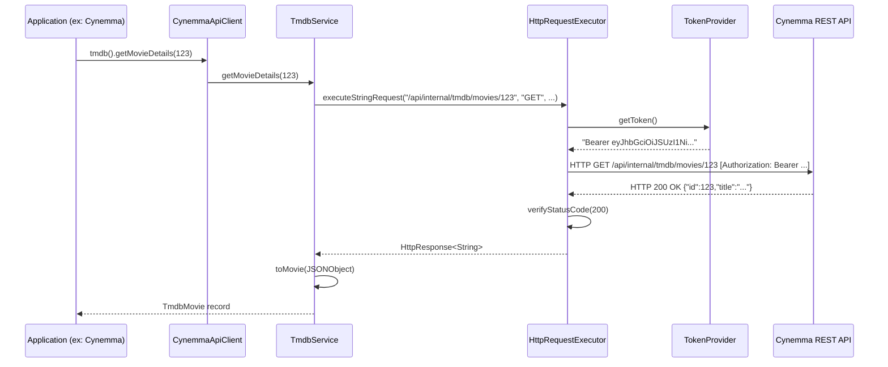

# Architecture Technique de `cynemma-api-client`

## 1. Principes de Conception

1. **Découplage Strict** :
   - Le SDK ne dépend ni de l'application web principale `cynemma` (WAR) ni de l'application REST `cynemma-api` (WAR).
   - Il s'agit d'une bibliothèque JAR autonome (`fr.turgot:cynemma-api-client:1.0.0`).
2. **Utilisation des fonctionnalités natives du JDK 21** :
   - Java Records pour les DTOs immuables (`TmdbMovie`, `TrailerResponse`, `HealthResponse`, `TrailerCacheRequest`).
   - `java.net.http.HttpClient` standard pour les requêtes asynchrones et synchrones HTTP/1.1 et HTTP/2.
3. **Séparation Interface / Implémentation** :
   - Exposition d'interfaces publiques de haut niveau (`CynemmaApiClient`, `HealthService`, `TrailerService`, `TmdbService`, `TokenProvider`).
   - Implémentations privées ou de package (`DefaultCynemmaApiClient`, `DefaultHealthService`, `DefaultTrailerService`, `DefaultTmdbService`, `HttpRequestExecutor`).

---

## 2. Organisation des Packages

```
fr.turgot.client
├── CynemmaApiClient.java              <- Interface racine du SDK
├── CynemmaApiClientBuilder.java       <- Constructeur fluide avec options
├── DefaultCynemmaApiClient.java       <- Implémentation coordonnant les services
├── auth
│   ├── TokenProvider.java             <- Interface fonctionnelle pour tokens JWT
│   └── StaticTokenProvider.java       <- Implémentation d'un token fixe
├── dto
│   ├── HealthResponse.java            <- Record statut microservice & DB
│   ├── TmdbMovie.java                 <- Record représentant un film TMDB
│   ├── TrailerCacheRequest.java       <- Record payload de mise en cache
│   └── TrailerResponse.java           <- Record URLs & clé YouTube
├── exception
│   ├── CynemmaApiException.java       <- Exception racine
│   ├── CynemmaAuthenticationException.java (401)
│   ├── CynemmaForbiddenException.java      (403)
│   ├── CynemmaNetworkException.java        (I/O, timeout)
│   ├── CynemmaNotFoundException.java       (404)
│   ├── CynemmaServiceUnavailableException.java (502/503/504)
│   └── CynemmaValidationException.java     (400)
├── http
│   └── HttpRequestExecutor.java       <- Moteur d'exécution HTTP sécurisé
└── service
    ├── HealthService.java / DefaultHealthService.java
    ├── TmdbService.java   / DefaultTmdbService.java
    └── TrailerService.java/ DefaultTrailerService.java
```

---

## 3. Flux d'une Requête Typique



---

## 4. Intégration dans `cynemma`

Dans l'application principale, la classe `fr.turgot.service.TmdbApiClient` a été refondue en un adaptateur qui encapsule `CynemmaApiClient`. Elle délègue intégralement le transport, l'authentification et le typage au SDK, tout en garantissant 100% de rétro-compatibilité sans régression sur les servlets `TmdbCatalogImportServlet`, `TrailerServlet` et leurs tests unitaires.
